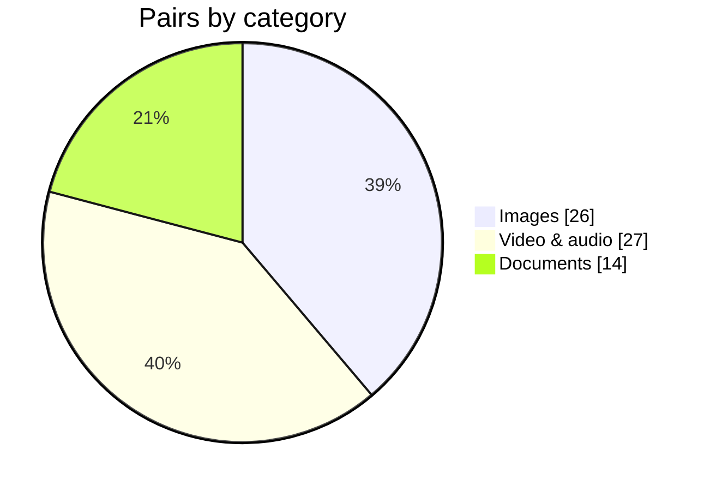

  

# FilePrism

An online file converter. Images are processed in the browser; video, audio and documents on the server.

[Русский](README.md)

FilePrism covers 67 format pairs, 18 guides and 243 pages in Russian and English. I built it around a simple idea: converting a file should not require an account, an install, or sending your photos to someone else’s server when the browser can do the job.

## What's inside

| Pairs | Guides | Hubs | Pages |
|---:|---:|---:|---:|
| 67 | 18 | 23 | 243 |

26 pairs convert in the browser; 41 run on the server.

## Screenshots

  

<table>
  <tr>
    <td width="50%">
      
    </td>
    <td width="50%">
      
    </td>
  </tr>
</table>

  

## Why images stay in the browser

Photos are the most common case. If someone needs JPG to PNG or HEIC to JPG, sending the file to a server and back is often unnecessary. The browser can decode the image and draw it on a Canvas, so the conversion happens locally and the server is only used when the browser cannot handle the format.

It is faster, uses less traffic and keeps personal photos on the device. HEIC goes through heic2any; everything else uses Canvas and WebCodecs. If a format such as TIFF or SVG cannot be handled in the browser, the server path takes over.

## How the server works

Video, audio and documents need FFmpeg, LibreOffice and Poppler, so those files go to the server:

`nginx → Next.js API → Redis/BullMQ → worker`

The API checks the file signature, size and limits, stores the upload and creates a job. The worker takes one job at a time and runs the right tool: FFmpeg for video and audio, LibreOffice for DOCX/XLSX/PPTX, Poppler for PDF, sharp for images and ICO, pdf2docx for PDF to DOCX.

The result sits in a shared volume. The client polls for progress and downloads the file. Everything is removed after download or by TTL.

  

## What it supports

- **Images:** JPG, PNG, WebP, HEIC, AVIF, BMP, TIFF, SVG and ICO. Most of them convert in the browser.
- **Video and audio:** MP4, MOV, WebM, MKV, AVI, GIF, MP3, M4A, WAV and OGG.
- **Documents:** PDF, DOCX, XLSX, PPTX, HTML, CSV, TXT and images to PDF.

Limits are sized for a small server: images up to 25 MB, video and audio up to 100 MB and 5 minutes, documents up to 25 MB.

## A few details that mattered

- **One conversion registry.** Routes, pages, limits and engine selection all come from it. Adding a pair is data and content, not a new page template.
- **Content as data.** Pair pages and guides live in MDX and are validated at build time. A missing translation fails the build, which keeps the two languages honest.
- **Isolated LibreOffice profiles.** Each job gets its own profile; otherwise concurrent conversions start fighting each other.
- **Real MIME surprises.** AVI may be detected as `video/vnd.avi`, SVG is text, and some BMP variants are not readable by sharp directly. Those cases have careful fallbacks.
- **A queue without heroics.** One worker, clear limits, timeouts and cleanup. On a small VPS that is more reliable than trying to do everything at once.

## Stack

  

Next.js 16, React 19, TypeScript and Tailwind CSS 4 on the front end. Redis and BullMQ for the queue. FFmpeg, LibreOffice, Poppler, pdf2docx and sharp for conversions. Docker Compose, nginx and certbot for deployment. Vitest and Playwright for tests.

## Contact

Personal: **vladshumetov@gmail.com**  
Site support: **fileprism.support@gmail.com**  
GitHub: [@vladshumetov](https://github.com/vladshumetov)

© 2026 FilePrism

