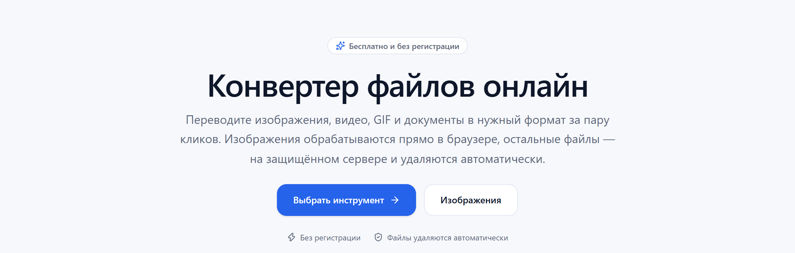
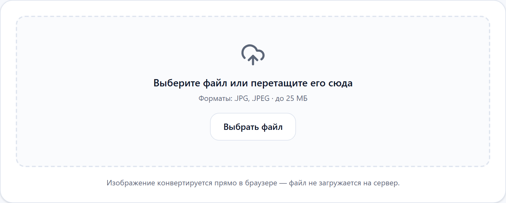
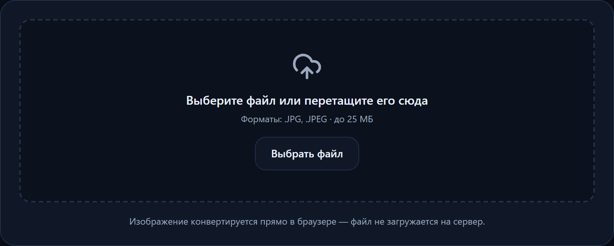
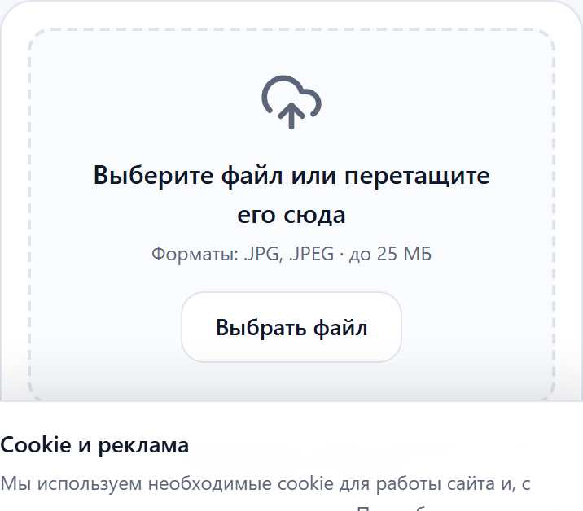
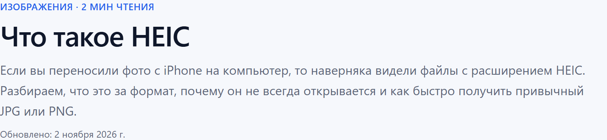

  

<h1 align="center">FilePrism</h1>

  A bilingual, privacy-first file converter for images, video, audio and documents. 
  Images convert in the browser. Everything else runs in an isolated server queue.

  
  
  
  
  

  
  
  
  
  

> **Status:** MVP ready. Public deployment is in progress. The production source code is private; this repository is a product and engineering case study.

## What it is

FilePrism is a production-shaped online file converter. It covers 67 format pairs across four categories and ships with 18 long-form guides, 23 format hubs and 243 static pages in Russian and English.

The core idea is a **hybrid conversion model**:

- **Images** are decoded and re-encoded in the browser with Canvas, WebCodecs and heic2any. They never leave the device when the browser can handle the format.
- **Video, audio and documents** go through nginx and a Next.js API, enter a Redis/BullMQ queue and are processed by a single worker using FFmpeg, LibreOffice, Poppler, sharp and pdf2docx.
- Results are served from a shared volume and deleted automatically after download or by TTL.

## Screenshots

  

<table>
  <tr>
    <td width="50%">
      
    </td>
    <td width="50%">
      
    </td>
  </tr>
  <tr>
    <td align="center">Converter — light theme</td>
    <td align="center">Converter — dark theme</td>
  </tr>
</table>

  

Mobile layout

  

One of 18 bilingual guides

## Highlights

| Area | Result |
|---|---|
| Conversions | 67 pairs across images, video, audio and documents |
| Content | 18 bilingual guides and 23 format hubs |
| Pages | 243 static pages in RU and EN |
| Privacy | Anonymous, no accounts, no history, automatic deletion |
| Limits | Images 25 MB; video/audio 100 MB, 5 min, Full HD; documents 25 MB |
| SEO | SSG, canonical, hreflang, `x-default`, sitemap, robots, JSON-LD |
| Monetisation | AdSense + Yandex RSYA slots, consent-gated, CLS-safe |
| Operations | Docker Compose, healthchecks, nginx TLS entrypoint, certbot |

## Architecture

  

The system is deliberately split into two paths:

1. **Local path.** The browser reads the file, converts it with Canvas/WebCodecs and downloads the result. No upload, no server CPU.
2. **Queued path.** nginx terminates TLS and proxies to Next.js. The API validates magic bytes and limits, stores the upload, creates a BullMQ job and returns a job id. A single worker processes the job and writes the result to a shared volume. The client polls for progress and downloads the result.

The worker runs with `concurrency: 1` to stay stable on small VPS instances. Cleanup removes expired jobs and files.

## Tech stack

| Layer | Stack |
|---|---|
| Web | Next.js 16 (App Router), React 19, TypeScript, Tailwind CSS 4 |
| UI | shadcn-style primitives, Lucide, Framer Motion, next-themes |
| API | Next.js route handlers, Node runtime, `file-type`, rate limiting |
| Queue | BullMQ + Redis, isolated jobs, progress, TTL cleanup |
| Video | FFmpeg (H.264, VP9, Opus, MP3, AAC, GIF palettes) |
| Documents | LibreOffice Writer/Calc/Impress, Poppler, pdf2docx, pdf-lib |
| Images | sharp on the server, Canvas/WebCodecs in the browser, heic2any |
| Infra | Docker Compose, nginx, certbot, healthchecks, shared volumes |
| Tests | Vitest, Playwright |

## Engineering notes

- **One conversion registry** drives routes, SEO pages, limits and engine selection. Adding a pair is a data change plus content, not a new page template.
- **Programmatic SEO** generates pair pages and format hubs from the registry. Content lives in typed MDX files and is validated at build time; missing translations fail the build.
- **Hybrid processing** keeps image traffic off the server and reserves the queue for heavier video, audio and document jobs.
- **Structured data** covers `WebSite`, `WebApplication`, `FAQPage`, `HowTo`, `CollectionPage`, `Article` and `BreadcrumbList`.
- **Ads and consent** are wired as provider-agnostic slots. Scripts load only after consent; reserved heights prevent layout shift.
- **Testing** includes unit tests for the registry, content schemas, SEO helpers and worker argument builders, plus Playwright E2E for the browser converter and language-switch persistence.

## Challenges solved

- **Browser vs server splitting.** Choosing which formats can be converted locally without hurting UX, and falling back to the server when the browser cannot encode a format.
- **Small-server stability.** A single worker, strict limits, queue caps, rate limiting, timeouts and automatic cleanup.
- **Document conversion.** Combining LibreOffice, Poppler, pdf2docx and pdf-lib behind one job interface, with per-job isolated LibreOffice profiles.
- **Bilingual SEO.** Keeping RU and EN page trees, metadata, sitemap and content validation in sync.
- **Real-world MIME differences.** Handling `video/vnd.avi`, SVG text detection and BMP variants that sharp cannot read directly.

## Roadmap

- [ ] Public deployment with HTTPS
- [ ] AdSense / Yandex RSYA and analytics IDs
- [ ] Search Console and Yandex Webmaster indexing
- [ ] Lighthouse mobile ≥ 90
- [ ] Streaming multipart uploads or stricter concurrency guard
- [ ] More format hubs, guides and backlinks

## Source and contact

The production source code is private. I am happy to walk through the architecture, trade-offs and implementation details.

- GitHub: [@vladshumetov](https://github.com/vladshumetov)
- Email: **fileprism.support@gmail.com**

## License

Showcase content © 2026 FilePrism. The production source code is not included and is not licensed for redistribution.
