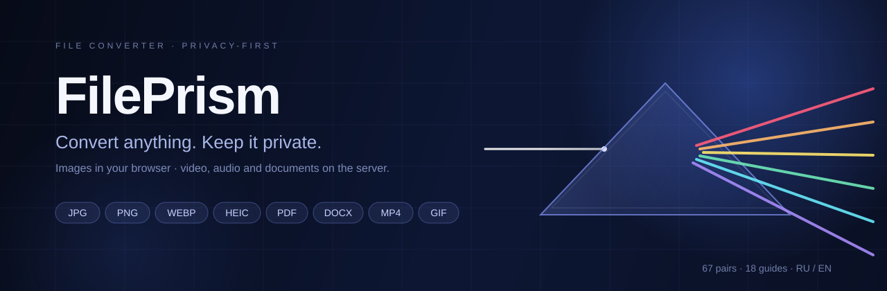
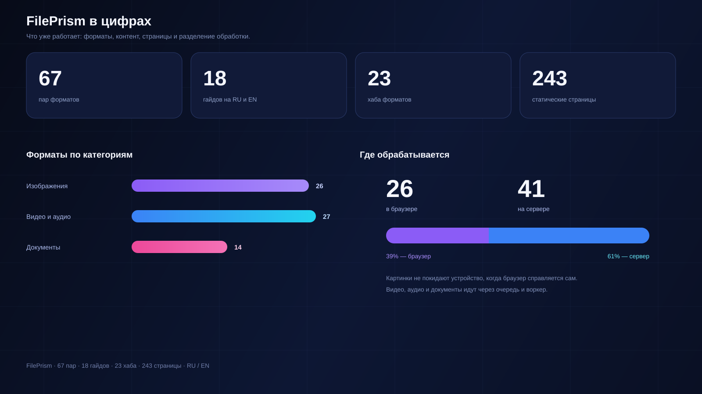
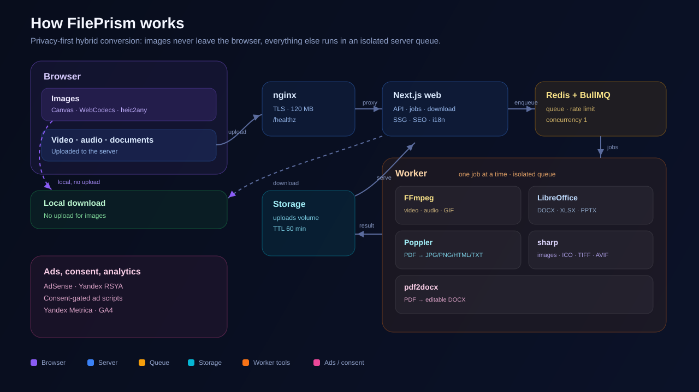

  

# FilePrism

Онлайн-конвертер файлов. Изображения обрабатываются прямо в браузере, видео, аудио и документы — на сервере.

[English](README.en.md)

FilePrism — это 67 пар форматов, 18 гайдов и 243 страницы на русском и английском. Я делал его вокруг одной простой мысли: конвертация не должна требовать аккаунта, установки программ и доверия к чужому серверу, если задачу можно решить на устройстве пользователя.

## Что внутри

  

67 пар — это не «все форматы мира», а те направления, которые действительно ищут: JPG в PNG, HEIC в JPG, PDF в DOCX, MP4 в GIF, XLSX в CSV и так далее. Под каждую пару есть отдельная страница, под каждый формат — хаб, а под частые вопросы — гайды.

## Скриншоты

  

<table>
  <tr>
    <td width="50%">
      
    </td>
    <td width="50%">
      
    </td>
  </tr>
</table>

  

## Почему изображения остаются в браузере

Фотографии — самый частый сценарий. Если человеку нужно перевести JPG в PNG или HEIC в JPG, гонять файл на сервер и обратно часто незачем. Браузер и так умеет декодировать изображение и отрисовать его на Canvas. Поэтому картинки обрабатываются локально, а сервер подключается только если браузер не справился с форматом.

Так быстрее, нет лишнего трафика и меньше поводов волноваться за приватность. Для HEIC используется heic2any, для остального — Canvas и WebCodecs. Если формат вроде TIFF или SVG браузер не тянет, включается серверный путь.

## Как работает серверная часть

Видео, аудио и документы — другая история. Здесь нужны FFmpeg, LibreOffice и Poppler, поэтому файл уходит на сервер. Цепочка выглядит так:

`nginx → API Next.js → Redis/BullMQ → worker`

API проверяет тип файла по сигнатуре, размер и лимиты, сохраняет загрузку и создаёт задачу. Воркер берёт одну задачу за раз и запускает нужный инструмент: FFmpeg для видео и аудио, LibreOffice для DOCX/XLSX/PPTX, Poppler для PDF, sharp для картинок и ICO, pdf2docx для PDF → DOCX.

Результат лежит в общем volume, клиент опрашивает прогресс и забирает файл. После скачивания или по TTL всё удаляется.

  

## Что поддерживается

- **Изображения:** JPG, PNG, WebP, HEIC, AVIF, BMP, TIFF, SVG и ICO. Большая часть конвертируется в браузере.
- **Видео и аудио:** MP4, MOV, WebM, MKV, AVI, GIF, MP3, M4A, WAV и OGG.
- **Документы:** PDF, DOCX, XLSX, PPTX, HTML, CSV, TXT и изображения в PDF.

Лимиты подобраны под небольшой сервер: изображения до 25 МБ, видео и аудио до 100 МБ и 5 минут, документы до 25 МБ.

## Пара деталей, которые оказались важными

- **Один реестр конвертаций.** Из него растут роуты, страницы, лимиты и выбор движка. Добавить новую пару — значит добавить данные и контент, а не новый шаблон.
- **Контент как данные.** Страницы пар и гайдов лежат в MDX и валидируются на сборке. Если забыть перевод, сборка не пройдёт. Это дисциплинирует.
- **Изолированные профили LibreOffice.** На каждую задачу — свой профиль, иначе параллельные конвертации начинают мешать друг другу.
- **Реальные MIME-сюрпризы.** AVI может определяться как `video/vnd.avi`, SVG вообще текстовый, а некоторые BMP sharp не читает напрямую. Для таких случаев есть аккуратные fallback-и.
- **Очередь без героизма.** Один воркер, понятные лимиты, таймауты и очистка. На слабом VPS это надёжнее, чем пытаться обработать всё сразу.

## Стек

Next.js 16, React 19, TypeScript и Tailwind CSS 4 на фронте. Redis и BullMQ для очереди. FFmpeg, LibreOffice, Poppler, pdf2docx и sharp для конвертации. Docker Compose, nginx и certbot для запуска. Vitest и Playwright для тестов.

## Контакты

Личная почта: **vladshumetov@gmail.com**  
Поддержка сайта: **fileprism.support@gmail.com**  
GitHub: [@vladshumetov](https://github.com/vladshumetov)

© 2026 FilePrism

